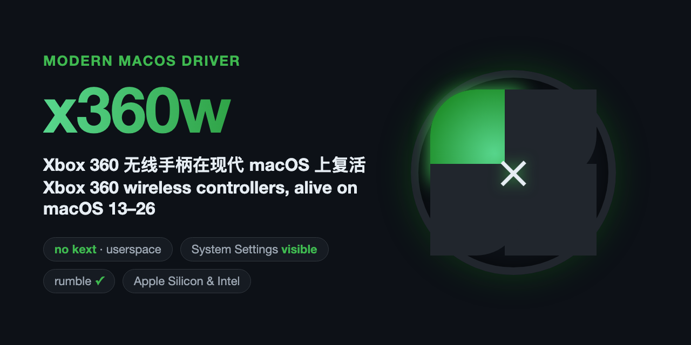
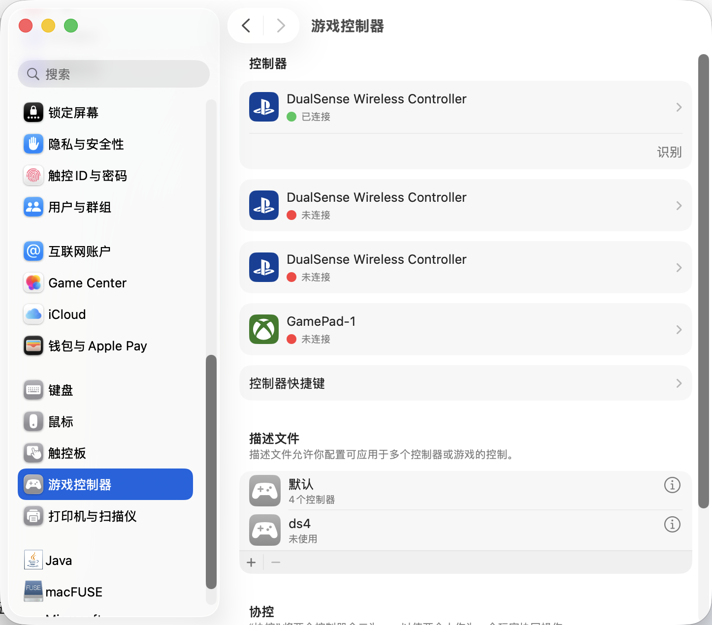
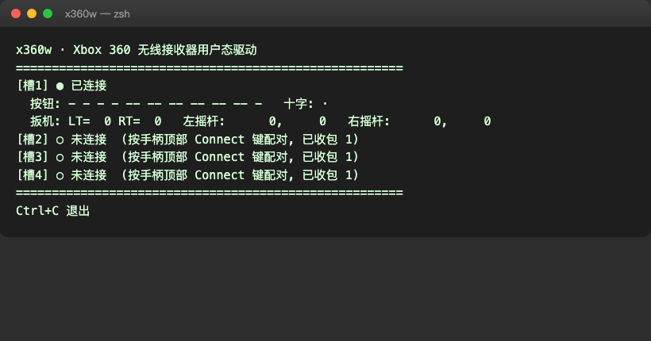

# x360w — Xbox 360 & GameSir Nova Lite Driver & WebUSB Extension for macOS



> ℹ️ **Fork Notice & Enhancements:**  
> This project is an enhanced fork of the original [x360w](https://github.com/古董修复师/x360w) by **古董修复师**.  
> This fork adds:
> - 🎮 **GameSir Nova Lite 2.4G Dongle Support** (VID `0x3537`, PID `0x1040` & `0x3151:0x3020`) with 20-byte XInput packet decoding at ~240 Hz.
> - 🌐 **Google Chrome WebUSB Extension (Modo A)**: Run the controller directly in Google Chrome (xCloud, GeForce NOW) with **AMFI 100% active and Netflix / Widevine DRM fully working**!
> - 🍎 **macOS Tahoe / 26+ Compatibility Fixes**: Fixed `SIGSEGV` crash in `vhid.c` caused by incorrect pointer dereference of `dlsym` dictionary callbacks.
> - ⚡ **Thread Race Condition Fix**: Eliminates instant false-disconnects on fast multi-core systems.
> - 🔄 **USB Pipe-Stall Auto Recovery**: Automatically clears halt states (`LIBUSB_ERROR_PIPE`) on the interrupt endpoints.
> - 🛠️ **Zero-Xcode Build Toolchain**: Compiles with standalone Zig (`zig cc`) without requiring Apple Xcode or Command Line Tools.

Use your **GameSir Nova Lite (via 2.4G USB Dongle)** or **original Xbox 360 controllers** (wireless receiver `045e:0291` / `0719` / `02a9` or wired `045e:028e`) on **macOS 13 → 26+ (Apple Silicon & Intel / Hackintosh)**!

---

## 🚀 Escolha o seu Modo de Uso

| Recurso | Modo A: Extensão Chrome (WebUSB) | Modo B: Driver Nativo (`x360w`) |
| :--- | :---: | :---: |
| **Onde roda** | Google Chrome (xCloud, GeForce NOW, web games) | Sistema macOS global (Emuladores, Unity, jogos nativos) |
| **Compatibilidade** | **Universal** (Apple Silicon M1/M2/M3/M4 & Hackintosh) | Hackintosh (OpenCore) ou Mac com AMFI configurado |
| **Netflix no Chrome** | ✅ **100% Funcional** (Widevine DRM intacto) | ✅ **Funcional com AMFIPass** (sem `amfi_get_out_of_my_way`) |
| **Requer modificar EFI/Kernel** | ❌ **NÃO** (zero modificações no sistema) | Sim (requer AMFIPass / boot-args) |
| **Instalação** | Carregar pasta `chrome-extension` no Chrome | Compilar ou executar `x360w-signed` |

---

### 🟢 Modo A: Google Chrome WebUSB Extension (Recomendado para xCloud & Netflix)

Se você joga principalmente pelo **Xbox Cloud Gaming (xCloud)** ou no navegador e não quer abrir mão de assistir **Netflix em 1080p** no Chrome:

1. Abra o **Google Chrome** e acesse `chrome://extensions`.
2. Ative o **Modo do desenvolvedor** no canto superior direito.
3. Clique em **Carregar sem compactação** e selecione a pasta `chrome-extension` deste repositório.
4. Conecte o dongle USB 2.4 GHz e ligue o GameSir Nova Lite (`Home + X`, LED verde).
5. Clique no ícone da extensão no Chrome e clique em **Conectar GameSir**.
6. Pronto! Acesse o [Xbox Cloud Gaming](https://www.xbox.com/play) ou o [Gamepad Tester](https://hardwaretester.com/gamepad).

👉 Leia o guia completo em [chrome-extension/README.md](chrome-extension/README.md).

---

### 🔵 Modo B: Driver Nativo de Sistema (DualSense / IOHIDUserDevice)

Para quem precisa do controle funcionando em emuladores e jogos standalone fora do navegador (Ryujinx, RPCS3, Dolphin, RetroArch, etc. — lembrando que a Steam já possui suporte próprio ao GameSir via Steam Input sem requerer este driver):

1. **Compilar e Assinar:**
   ```bash
   bash scripts/build.sh
   sudo codesign --force --deep --sign - --entitlements entitlements.plist x360w-signed
   sudo xattr -cr x360w-signed
   ```
2. **Executar:**
   ```bash
   ./x360w-signed
   ```
3. **Hackintosh Users:**  
   Consulte nosso guia detalhado em **[docs/HACKINTOSH.md](docs/HACKINTOSH.md)** para saber como utilizar o `AMFIPass.kext` e manter o Widevine do Chrome ativo.

---

## 🕹️ Funcionalidades do Driver Nativo

- 🎮 **Suporte Completo** — GameSir Nova Lite 2.4G, Xbox 360 Wireless & Wired, botões, D-Pad, analógicos, gatilhos analógicos e reconexão automática.
- 🖥️ **Duas Identidades de Saída**
  - **Clone DualSense (Padrão)** — Sony DualSense exato (`054c:0ce6`, descritor USB oficial de 273 bytes). Reconhecido nativamente pelo `GameController.framework`, Ajustes do Sistema e jogos da Mac App Store.
  - **Gamepad Genérico** (`--identity generic`) — 16 botões + hat + 6 eixos.
- 🔁 **Vibração (Rumble)** — Saídas HID encaminhadas aos motores do controle.
- 🪶 **Sem kexts ou DriverKit** — Binário em C leve em espaço de usuário, pronto para `launchd`.

---

## 📸 Screenshots

| Ajustes do Sistema → Controles | Dashboard ao Vivo no Terminal |
|---|---|
|  |  |

---

## 📂 Estrutura do Repositório

```text
chrome-extension/  Extensão Manifest V3 para Google Chrome (Modo A WebUSB)
src/               x360w.c (USB + protocolo) · vhid.c/h (HID virtual) · ds_desc.h
docs/              Guias detalhados (HACKINTOSH.md, INSTALL.md)
scripts/           build.sh (compilação independente) · verify.sh
packaging/         com.x360w.driver.plist (serviço de inicialização launchd)
```

---

## 📄 Licença e Créditos

Distribuído sob a licença MIT (consulte [LICENSE](LICENSE)).  
Projeto baseado no [x360w](https://github.com/古董修复师/x360w) de **古董修复师**.  
Conhecimento de protocolo derivado do `xpad.c` do Linux; descritor DualSense documentado por @nondebug; pesquisas de AMFI por Lumen e X360MacOSReceiverBridge.  
Consulte todas as atribuições em [NOTICE](NOTICE).
